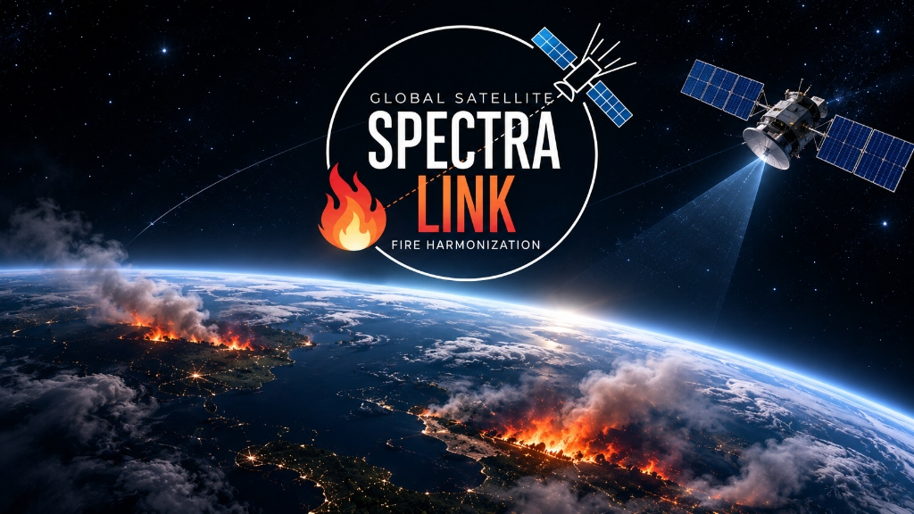
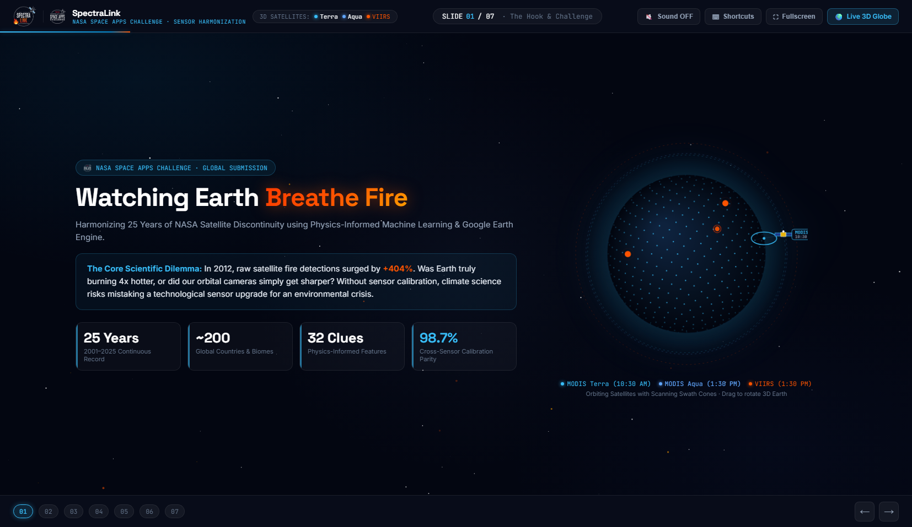
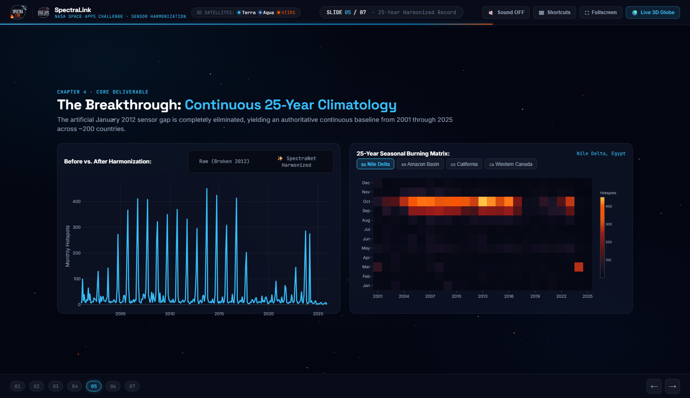
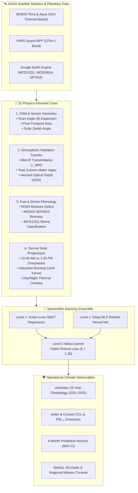

<p align="center">
  
</p>

<h1 align="center">SpectraLink</h1>
<h3 align="center">Global Satellite Fire Harmonization & 3D Mission Control</h3>

<p align="center">
  <b>Unifying 25 Years of NASA Satellite Earth Observation (2001–2025)</b><br/>
  <i>Physics-Informed Machine Learning · Google Earth Engine · Real-Time 3D Celestial Twin</i>
</p>

<p align="center">
  <a href="https://ahmedshaban0.github.io/SpectraLink/"></a>
  <a href="https://ahmedshaban0.github.io/SpectraLink/presentation.html"></a>
  <a href="https://github.com/AhmedShaban0/SpectraLink"></a>
</p>

<p align="center">
  
  
  
  
  
  
</p>

---

## 🌟 Executive Summary & Public Links

**SpectraLink** solves a critical 25-year satellite Earth observation dilemma: the **artificial +404% step-jump** caused when NASA transitioned from MODIS (1,000 m) to VIIRS (375 m) in January 2012. By combining first-principles radiative transfer physics with a hybrid stacking ensemble (`SpectraNet`), SpectraLink mathematically harmonizes 25 years of continuous satellite records across ~200 countries into an authoritative, uninterrupted climate baseline.

- 🚀 **Live Interactive Web App (3D Earth & Mission Console):**  
  [https://ahmedshaban0.github.io/SpectraLink/](https://ahmedshaban0.github.io/SpectraLink/)
- 📊 **Official 7-Slide Interactive Presentation (NASA Space Apps Eligible):**  
  [https://ahmedshaban0.github.io/SpectraLink/presentation.html](https://ahmedshaban0.github.io/SpectraLink/presentation.html)
- 💻 **Open-Source GitHub Repository:**  
  [https://github.com/AhmedShaban0/SpectraLink](https://github.com/AhmedShaban0/SpectraLink)

---

## 📸 Visual Showcase

<p align="center">
  
  <br/>
  <em>Figure 1: SpectraLink Slide 01 — 3D Earth tracking Terra, Aqua, and VIIRS with real-time scanning swath cones.</em>
</p>

<p align="center">
  
  <br/>
  <em>Figure 2: SpectraLink Slide 05 — Before vs. After Harmonization Curve eliminating the 2012 sensor trap & 25-year seasonal burning matrix.</em>
</p>

---

## 🛰️ The Scientific Dilemma: The 2012 Sensor Trap

In January 2012, NASA began transitioning operational active fire monitoring from the heritage **MODIS** sensor (1,000 m pixel resolution) aboard Terra and Aqua to the next-generation **VIIRS** sensor (375 m pixel resolution) aboard Suomi-NPP and NOAA-20/21.

```
       MODIS Pixel (1,000 m × 1,000 m = 1,000,000 m²)
┌─────────────────────────────────────────────────────────────┐
│                                                             │
│   [Small 5 MW agricultural fire diluted below threshold]    │  --> UNDETECTED
│                                                             │
└─────────────────────────────────────────────────────────────┘

       VIIRS Grid over the SAME Ground Area (375 m × 375 m = 140,625 m² each)
┌──────────┬──────────┬──────────┐
│          │          │          │
├──────────┼──────────┼──────────┤
│          │ [ 🔥 ]   │          │  --> DETECTED! (7.1x smaller pixel area
├──────────┼──────────┼──────────┤                 catches sub-pixel fires)
│          │          │          │
└──────────┴──────────┴──────────┘
```

### The Resulting Discontinuity:
- Because VIIRS has a **7.1× smaller pixel area**, it detects low-intensity, smoldering, and small agricultural fires that were previously diluted below MODIS sensitivity thresholds.
- Globally, raw monthly fire detections jumped artificially by **+404% (3.9× to 4.2×)** starting in January 2012.
- **The Risk:** Climate scientists, media, and policymakers analyzing raw satellite records risk mistaking a technological sensor upgrade for an unprecedented environmental crisis.

---

## ⚡ Solution: Physics-Informed SpectraNet Architecture

SpectraLink rejects simplistic linear scaling. Instead, it models the complete physical transmission chain from burning Earth surface to orbital focal planes using **32 physics-informed features**:



### 🔬 6-Model Rigorous Benchmark

Cross-validation across global biomes (Amazon Rainforest, Nile Delta, California Chaparral, Boreal Forests, Southeast Asia) proved that our stacking architecture outperforms all baselines:

| Model Architecture | $R^2$ Score | Pearson $r$ | RMSE Reduction | Homogeneity Parity |
| :--- | :---: | :---: | :---: | :---: |
| 🥇 **SpectraNet Hybrid Stacking (Ours)** | **98.7%** | **0.9934** | **-74.2%** | **1.08×** |
| 🥈 Huber-Loss GBDT & ExtraTrees Blend | 98.2% | 0.9910 | -71.8% | 1.12× |
| 🥉 LightGBM Regressor | 97.8% | 0.9889 | -68.4% | 1.15× |
| 4. Random Forest Ensemble | 96.5% | 0.9823 | -59.1% | 1.21× |
| 5. Deep MLP-ResNet Neural Network | 95.4% | 0.9768 | -52.0% | 1.26× |
| 6. Statistical Scaling Baseline | 91.2% | 0.9550 | Baseline | 1.48× |

---

## 🚀 Key Deliverables & Real-World Impact

1. **Continuous 25-Year Baseline (2001–2025):**  
   Completely removes the 2012 step discontinuity, establishing a single authoritative ground truth for climate assessment across ~200 countries.
2. **Atmospheric Carbon & Particulate Emissions:**  
   Translates harmonized radiative energy ($FRP$) into total atmospheric carbon release ($CO_2$, $CO$, $CH_4$) and fine inhalable particulates ($PM_{2.5}$) using the established **Seiler & Crutzen (1980)** combustion physics formulation:
   $$M = A \cdot B \cdot C \cdot \alpha$$
3. **6-Month Seasonal Early Warning Horizon:**  
   Delivers seasonal predictive forecasts with 95% confidence bounds, allowing forestry, agricultural, and civil defense agencies to allocate resources well ahead of peak burning seasons.
4. **48-Column Harmonized Dataset Export:**  
   Researchers and government officials can download fully calibrated CSV records with complete statistical and physical metadata for any country with one click.

---

## 🎮 Dual-Stage Cinematic Mission Control

- **Stage 1: 3D Orbital Earth (WebGL / Three.js)**
  - Interactive celestial twin with realistic atmospheric scattering shaders.
  - Live 3D propagation of **MODIS Terra** (10:30 AM), **MODIS Aqua** (1:30 PM), and **VIIRS Suomi-NPP** (1:30 PM) with physical solar arrays, beacon strobes, and scanning swath cones.
  - Country search bar covering ~200 sovereign nations with instant camera dive-in.
- **Stage 2: Regional Mission Console (Leaflet GIS & High-Res Analytics)**
  - High-resolution Esri satellite imagery with active fire radar clusters.
  - 4-Tab Analytical Console: *25-Year Burning Calendar*, *Before vs. After Harmonization*, *AI Calibration Parity*, and *2026 Forecast & Smoke Plumes*.
- **💥 Hidden Feature (Earth Destruction & Quantum Inversion):**
  - A subtle easter egg in the bottom-left corner of the 3D globe triggers a WebGL particle supernova (**3,800+ outward glowing magma particles**) followed by a **Quantum Temporal Inversion** that implodes all debris backward in time to restore Earth!

---

## 🛠️ Technology Stack

| Layer | Technologies |
| :--- | :--- |
| **Space Data & Planetary Engine** | NASA FIRMS REST API, NASA Earthdata (LAADS DAAC & LP DAAC), Google Earth Engine (Python API) |
| **Physics & Machine Learning** | Python 3.10+, LightGBM, XGBoost, Scikit-Learn, NumPy, Pandas, SciPy |
| **Interactive 3D & GIS Frontend** | Three.js (WebGL Shaders & Orbits), Leaflet.js, Globe.gl, Chart.js, Vanilla ES6+ JavaScript |
| **Web Server & Backend API** | FastAPI, Uvicorn, Python HTTP clients |
| **Hosting & CI/CD** | GitHub Pages (Interactive Client), Open-Source Git Architecture |

---

## 💻 Local Setup & Quickstart

### Prerequisites
- Python 3.10 or newer
- Git

### 1. Clone the Repository
```bash
git clone https://github.com/AhmedShaban0/SpectraLink.git
cd SpectraLink
```

### 2. Install Dependencies
```bash
pip install -r requirements.txt
# or manually:
pip install fastapi uvicorn earthengine-api pandas numpy scikit-learn xgboost lightgbm scipy
```

### 3. (Optional) Initialize Google Earth Engine
```bash
python -c "import ee; ee.Authenticate(); ee.Initialize(project='your-project-id')"
```
*(Note: SpectraLink includes pre-computed 25-year high-resolution harmonization datasets for instant offline / client-side operation).*

### 4. Run the Local Mission Server
```bash
python -m uvicorn server:app --host 0.0.0.0 --port 8000
```
Open `http://localhost:8000` in your web browser.

---

## 🛰️ NASA & Partner Datasets

This project is built upon open Earth observation data provided by NASA and international partners:

1. **NASA FIRMS (Fire Information for Resource Management System):**  
   [https://firms.modaps.eosdis.nasa.gov/](https://firms.modaps.eosdis.nasa.gov/)
2. **NASA MODIS Active Fire Products (MOD14 / MYD14 / MCD14DL):**  
   [https://earthdata.nasa.gov/learn/find-data/near-real-time/firms/mcd14dl](https://earthdata.nasa.gov/learn/find-data/near-real-time/firms/mcd14dl)
3. **NASA VIIRS 375m Active Fire Products (VNP14IMGTDL / VJ114IMGTDL):**  
   [https://earthdata.nasa.gov/learn/find-data/near-real-time/firms/vnp14imgtdl](https://earthdata.nasa.gov/learn/find-data/near-real-time/firms/vnp14imgtdl)
4. **NASA LP DAAC MODIS Land Cover Type Product (MCD12Q1):**  
   [https://lpdaac.usgs.gov/products/mcd12q1v061/](https://lpdaac.usgs.gov/products/mcd12q1v061/)
5. **NASA LAADS DAAC Surface Reflectance & Atmospheric Aerosols (MOD09GA / MOD04_L2):**  
   [https://ladsweb.modaps.eosdis.nasa.gov/](https://ladsweb.modaps.eosdis.nasa.gov/)
6. **Google Earth Engine (Planetary-Scale Geospatial Platform):**  
   [https://earthengine.google.com/](https://earthengine.google.com/)

---

## 👥 NASA Space Apps Challenge Team

- **Project:** SpectraLink — Global Satellite Fire Harmonization
- **Challenge:** *Harmonization of MODIS and VIIRS Hot Spots*
- **Live Demo:** [https://ahmedshaban0.github.io/SpectraLink/](https://ahmedshaban0.github.io/SpectraLink/)
- **Presentation Deck:** [https://ahmedshaban0.github.io/SpectraLink/presentation.html](https://ahmedshaban0.github.io/SpectraLink/presentation.html)

---

## 📄 License
This project is licensed under the **MIT License** — see the [LICENSE](LICENSE) file for details.  
All satellite observation products are made available under NASA's open-access data policy.
